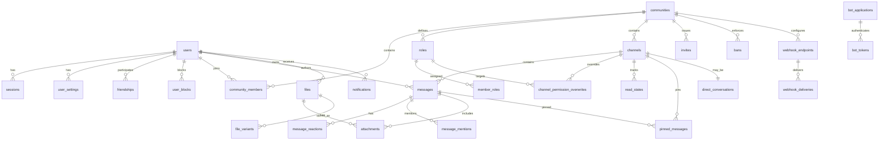

# Tulpar Database Design

**Status:** Phase 3 complete for the v1 backend scope. Migrations `0001`–`0004` implement identity, sessions, communities, permissions, channels, social metadata, messages, reactions, mentions, pins, read states, attachments, notifications, and notification preferences. Voice, integration, and embed tables remain planned; S3/MinIO storage and multi-node event fan-out are follow-ups.

**Database:** PostgreSQL 16 or newer.

This document is the source of truth for the relational model. Phase 1 implements the subset listed above; later migrations must match the remaining definitions or update this document with a reviewed decision.

---

## 1. Principles

1. **PostgreSQL is the only source of truth for durable state.** Redis never holds data that cannot be rebuilt.
2. **Constraints belong in the database.** Foreign keys, check constraints, partial unique indexes, and `NOT NULL` are used wherever they express a real invariant.
3. **Public identifiers are UUIDv7.** Generated by the application (`uuid` crate v7) for time-ordered, globally unique IDs. No public `BIGSERIAL` IDs.
4. **All timestamps are UTC `timestamptz`.** The API renders RFC 3339.
5. **Migrations are append-only after the first public release.** Destructive changes use the expand/contract pattern.
6. **Soft delete only where recovery or audit requires it.** Sessions, tokens, reactions, read states, and join rows are hard-deleted. Communities, channels, messages, and accounts use `deleted_at` plus a purge policy.
7. **No secrets in plaintext.** Refresh tokens, verification tokens, reset tokens, API keys, and bot tokens are stored as SHA-256 hashes. Webhook signing secrets are stored encrypted with an application master key because they must be recoverable to sign deliveries.
8. **A crate owns writes to its tables.** Read-only joins across domains are allowed; cross-domain writes go through the owning service.
9. **Every query is parameterized.** Dynamic SQL is limited to a small allowlist of sort/filter clauses.
10. **No unbounded scans.** Every list endpoint has a cursor and a limit; every foreign-key lookup has an index.

---

## 2. Conventions

### 2.1 Naming

- Tables: plural `snake_case`.
- Columns: singular `snake_case`.
- Primary key: `id`.
- Foreign keys: `<entity>_id`.
- Timestamps: `created_at`, `updated_at`, `deleted_at`, plus domain-specific names.
- Join tables: `<entity_a>_<entity_b>` or a descriptive plural when the row has meaning.
- Indexes: `idx_<table>_<columns>_<qualifier>`.
- Unique indexes: `uq_<table>_<columns>`.
- Check constraints: `ck_<table>_<rule>`.
- Foreign keys: `fk_<table>_<target>`.

### 2.2 Types

| Concept | Type | Notes |
|---|---|---|
| Public ID | `uuid` | UUIDv7, generated in Rust |
| Short text | `text` with `CHECK (char_length(...) BETWEEN ...)` | No arbitrary `varchar(n)` limits |
| Case-insensitive username/email | `citext` | Requires `citext` extension |
| Timestamp | `timestamptz` | UTC; no `timestamp without time zone` |
| IP address | `inet` | Never exposed to other users |
| Token hash | `bytea` | SHA-256, 32 bytes |
| Permission set | `bigint` | Bits 0–62; bit 63 reserved; API exposes string arrays |
| Arbitrary structured data | `jsonb` | Validated by application; no secrets |
| Encrypted secret | `bytea` | XChaCha20-Poly1305 with a versioned key |
| Full-text vector | `tsvector` | Generated from content with the `simple` dictionary |

### 2.3 Extensions

```sql
CREATE EXTENSION IF NOT EXISTS citext;
CREATE EXTENSION IF NOT EXISTS pg_trgm;
```

`citext` provides case-insensitive usernames and emails. `pg_trgm` provides fuzzy search for usernames, display names, community names, and partial message matching. Both are standard PostgreSQL contrib modules and are available in the official Docker image and on common managed providers.

The initial migration attempts to create both extensions. If the application role lacks `CREATE EXTENSION` permission on a managed provider, the operator must create them as an administrator before running migrations; the migration then verifies their presence and fails with a clear error if they are missing. No extension requires a custom shared library.

### 2.4 Enumerations

PostgreSQL `ENUM` types are intentionally avoided. Status columns use `text` plus `CHECK` constraints. This keeps migrations simple and avoids the operational pain of altering enum types. Application enums mirror the checks.

### 2.5 Soft delete and uniqueness

Partial unique indexes use `WHERE deleted_at IS NULL` where a deleted resource should not block reuse. Account deletion anonymizes the username and email and records a 90-day username reservation, so the original identity cannot be immediately impersonated. See §12.

### 2.6 Foreign key actions

| Relationship | Action | Reason |
|---|---|---|
| Session → refresh tokens | `ON DELETE CASCADE` | Tokens are meaningless without a session |
| Community → members/roles/channels/invites/bans | `ON DELETE CASCADE` | Hard purge removes the community's dependent state |
| Channel → messages/overwrites/pins/read states | `ON DELETE CASCADE` | Hard purge removes channel content |
| Message → reactions/mentions/attachments/pins | `ON DELETE CASCADE` | Dependent rows have no meaning alone |
| User → authored messages | `ON DELETE SET NULL` | Messages can survive account deletion with an anonymous author |
| User → audit actor | `ON DELETE SET NULL` | Audit history must survive account deletion |
| Role → member role assignments / overwrites | `ON DELETE CASCADE` | Assignment is invalid without the role |
| File → attachment | `ON DELETE RESTRICT` | A ready file cannot silently disappear while referenced |
| Community owner | `ON DELETE RESTRICT` | Ownership must be transferred or the community deleted first |

---

## 3. Entity relationship overview



---

## 4. Platform tables

### 4.1 `instance_settings`

Dynamic instance settings that an administrator can change without editing files. Static configuration and secrets stay in the environment/config file.

| Column | Type | Constraints |
|---|---|---|
| `key` | `text` | Primary key |
| `value` | `jsonb` | `NOT NULL` |
| `updated_at` | `timestamptz` | `NOT NULL DEFAULT now()` |
| `updated_by` | `uuid` | `REFERENCES users(id) ON DELETE SET NULL` |

Examples: registration enabled, maintenance message, discovery enabled, default locale. Secrets are never stored here.

### 4.2 `outbox_events`

Transactional outbox for reliable event publication and webhook delivery.

| Column | Type | Constraints |
|---|---|---|
| `id` | `bigint GENERATED ALWAYS AS IDENTITY` | Primary key; internal ordering only |
| `event_id` | `uuid` | `NOT NULL UNIQUE`; stable public event ID |
| `topic` | `text` | `NOT NULL`; e.g. `message.created` |
| `aggregate_type` | `text` | `NOT NULL` |
| `aggregate_id` | `uuid` | Nullable |
| `community_id` | `uuid` | Nullable; no FK so deletion events survive |
| `payload` | `jsonb` | `NOT NULL` |
| `created_at` | `timestamptz` | `NOT NULL DEFAULT now()` |
| `available_at` | `timestamptz` | `NOT NULL DEFAULT now()` |
| `attempts` | `integer` | `NOT NULL DEFAULT 0` |
| `last_error` | `text` | Nullable, truncated |
| `processed_at` | `timestamptz` | Nullable |

Indexes:

- `idx_outbox_pending ON outbox_events (available_at) WHERE processed_at IS NULL`
- `idx_outbox_community ON outbox_events (community_id, created_at DESC)`
- `idx_outbox_event_id ON outbox_events (event_id)` via unique constraint

### 4.3 `idempotency_keys`

| Column | Type | Constraints |
|---|---|---|
| `actor_id` | `uuid` | `NOT NULL` |
| `actor_type` | `text` | `NOT NULL CHECK (actor_type IN ('user','bot','api_key'))` |
| `key` | `text` | `NOT NULL`; client-supplied |
| `endpoint` | `text` | `NOT NULL` |
| `request_hash` | `bytea` | `NOT NULL` |
| `response_status` | `smallint` | Nullable |
| `response_body` | `jsonb` | Nullable |
| `created_at` | `timestamptz` | `NOT NULL DEFAULT now()` |
| `expires_at` | `timestamptz` | `NOT NULL` |

Primary key: `(actor_id, key)`. Index `expires_at` for cleanup. A different request hash for the same key returns `409`.

---

## 5. Identity and authentication

### 5.1 `users`

| Column | Type | Constraints |
|---|---|---|
| `id` | `uuid` | Primary key |
| `username` | `citext` | `NOT NULL UNIQUE`; 2–32 chars, `^[a-z0-9_.-]+$` after normalization |
| `display_name` | `text` | `NOT NULL`; 1–64 chars |
| `email` | `citext` | `NOT NULL UNIQUE` |
| `email_verified_at` | `timestamptz` | Nullable |
| `password_hash` | `text` | Nullable for bots and deleted accounts; Argon2id PHC string |
| `avatar_file_id` | `uuid` | Nullable; FK added after `files` exists |
| `bio` | `text` | Nullable; max 500 chars |
| `locale` | `text` | `NOT NULL DEFAULT 'en'` |
| `preferred_status` | `text` | `NOT NULL DEFAULT 'online' CHECK IN ('online','idle','dnd','invisible')` |
| `is_bot` | `boolean` | `NOT NULL DEFAULT false` |
| `bot_owner_id` | `uuid` | `REFERENCES users(id) ON DELETE CASCADE` |
| `auth_version` | `integer` | `NOT NULL DEFAULT 0`; bumped on security-sensitive changes |
| `disabled_at` | `timestamptz` | Nullable; instance-level suspension |
| `disabled_reason` | `text` | Nullable |
| `last_seen_at` | `timestamptz` | Nullable; coarse, privacy-respecting |
| `created_at` | `timestamptz` | `NOT NULL DEFAULT now()` |
| `updated_at` | `timestamptz` | `NOT NULL DEFAULT now()` |
| `deleted_at` | `timestamptz` | Nullable |

Checks:

- `ck_users_password`: `(is_bot AND password_hash IS NULL) OR (NOT is_bot AND (password_hash IS NOT NULL OR deleted_at IS NOT NULL))`.
- `ck_users_bot_owner`: `(is_bot AND bot_owner_id IS NOT NULL) OR (NOT is_bot AND bot_owner_id IS NULL)`.
- Username format and display-name length checks.
- `ck_users_bot_not_admin` is enforced by not inserting bots into `instance_admins`.

Indexes:

- Unique `username`, unique `email`.
- `idx_users_created_at (created_at)`.
- `idx_users_bot (is_bot) WHERE is_bot = true`.
- `idx_users_username_trgm ON users USING gin ((username::text) gin_trgm_ops)`; the explicit cast is required because `username` is `citext`.
- `idx_users_display_name_trgm ON users USING gin (display_name gin_trgm_ops)`.
- `idx_users_deleted (deleted_at) WHERE deleted_at IS NOT NULL` for purge.

`avatar_file_id` references `files(id) ON DELETE SET NULL`. The FK is added after both tables exist to avoid a cyclic creation dependency.

### 5.2 `username_reservations`

| Column | Type | Constraints |
|---|---|---|
| `username` | `citext` | Primary key |
| `reserved_until` | `timestamptz` | `NOT NULL` |
| `reason` | `text` | `NOT NULL DEFAULT 'account_deleted'` |

Registration checks this table before accepting a username. A background job removes expired reservations.

### 5.3 `user_settings`

| Column | Type | Constraints |
|---|---|---|
| `user_id` | `uuid` | Primary key, `REFERENCES users(id) ON DELETE CASCADE` |
| `theme` | `text` | `NOT NULL DEFAULT 'dark' CHECK IN ('dark','light','system')` |
| `accent_color` | `text` | `NOT NULL DEFAULT '#7C5CFF'`; hex check |
| `compact_messages` | `boolean` | `NOT NULL DEFAULT false` |
| `show_typing_indicators` | `boolean` | `NOT NULL DEFAULT true` |
| `allow_friend_requests_from` | `text` | `NOT NULL DEFAULT 'everyone' CHECK IN ('everyone','mutual_communities','nobody')` |
| `allow_dms_from` | `text` | `NOT NULL DEFAULT 'friends' CHECK IN ('everyone','friends','mutual_communities','nobody')` |
| `presence_visibility` | `text` | `NOT NULL DEFAULT 'everyone' CHECK IN ('everyone','friends','nobody')` |
| `read_receipts` | `boolean` | `NOT NULL DEFAULT true` |
| `custom_status` | `text` | Nullable; max 128 chars |
| `custom_status_emoji` | `text` | Nullable; max 64 chars |
| `created_at` | `timestamptz` | `NOT NULL DEFAULT now()` |
| `updated_at` | `timestamptz` | `NOT NULL DEFAULT now()` |

The row is created with the user. Locale is stored on `users` so it can be used before settings load. Notification delivery preferences live in `notification_preferences`, not here, to keep one source of truth.

### 5.4 `instance_admins`

| Column | Type | Constraints |
|---|---|---|
| `user_id` | `uuid` | Primary key, `REFERENCES users(id) ON DELETE CASCADE` |
| `granted_by` | `uuid` | `REFERENCES users(id) ON DELETE SET NULL` |
| `created_at` | `timestamptz` | `NOT NULL DEFAULT now()` |

Instance administration is separate from community administration. The first admin is created by CLI after the database is empty; the system never promotes the first registrant automatically.

### 5.5 `sessions`

| Column | Type | Constraints |
|---|---|---|
| `id` | `uuid` | Primary key; also the `sid` JWT claim |
| `user_id` | `uuid` | `NOT NULL REFERENCES users(id) ON DELETE CASCADE` |
| `token_family_id` | `uuid` | `NOT NULL`; shared by rotated refresh tokens |
| `device_name` | `text` | Nullable; max 100 chars |
| `platform` | `text` | `NOT NULL CHECK IN ('web','desktop','embedded','api','bot')` |
| `ip` | `inet` | Nullable |
| `user_agent` | `text` | Nullable; max 512 chars |
| `created_at` | `timestamptz` | `NOT NULL DEFAULT now()` |
| `last_seen_at` | `timestamptz` | `NOT NULL DEFAULT now()` |
| `last_verified_at` | `timestamptz` | `NOT NULL DEFAULT now()`; last strong re-authentication |
| `expires_at` | `timestamptz` | `NOT NULL`; absolute session limit |
| `revoked_at` | `timestamptz` | Nullable |
| `revoked_reason` | `text` | Nullable |

Indexes:

- `idx_sessions_user_created (user_id, created_at DESC)`.
- `idx_sessions_active (user_id) WHERE revoked_at IS NULL`.
- `idx_sessions_expires (expires_at) WHERE revoked_at IS NULL`.
- `idx_sessions_family (token_family_id)`.

### 5.6 `refresh_tokens`

| Column | Type | Constraints |
|---|---|---|
| `id` | `uuid` | Primary key |
| `session_id` | `uuid` | `NOT NULL REFERENCES sessions(id) ON DELETE CASCADE` |
| `token_hash` | `bytea` | `NOT NULL UNIQUE`; SHA-256 of a 32-byte random token |
| `issued_at` | `timestamptz` | `NOT NULL DEFAULT now()` |
| `expires_at` | `timestamptz` | `NOT NULL` |
| `used_at` | `timestamptz` | Nullable; rotation time |
| `revoked_at` | `timestamptz` | Nullable |
| `replaced_by_id` | `uuid` | Nullable, `REFERENCES refresh_tokens(id) ON DELETE SET NULL` |

Index `idx_refresh_tokens_session (session_id, issued_at DESC)`. Reuse of a token whose `used_at` is set revokes the entire session family and creates a security event. Refresh tokens are never logged.

### 5.7 `email_verification_tokens`

| Column | Type | Constraints |
|---|---|---|
| `id` | `uuid` | Primary key |
| `user_id` | `uuid` | `NOT NULL REFERENCES users(id) ON DELETE CASCADE` |
| `token_hash` | `bytea` | `NOT NULL UNIQUE` |
| `expires_at` | `timestamptz` | `NOT NULL` |
| `consumed_at` | `timestamptz` | Nullable |
| `created_at` | `timestamptz` | `NOT NULL DEFAULT now()` |

Index `(user_id, expires_at)`. Only one active token is honored; issuing a new one marks older ones consumed.

### 5.8 `password_reset_tokens`

| Column | Type | Constraints |
|---|---|---|
| `id` | `uuid` | Primary key |
| `user_id` | `uuid` | `NOT NULL REFERENCES users(id) ON DELETE CASCADE` |
| `token_hash` | `bytea` | `NOT NULL UNIQUE` |
| `requested_ip` | `inet` | Nullable |
| `expires_at` | `timestamptz` | `NOT NULL` |
| `consumed_at` | `timestamptz` | Nullable |
| `created_at` | `timestamptz` | `NOT NULL DEFAULT now()` |

Index `(user_id, expires_at)`. A successful reset revokes all sessions for the user and bumps `auth_version`.

### 5.9 `device_authorizations`

Used by Tulpar Desktop.

| Column | Type | Constraints |
|---|---|---|
| `id` | `uuid` | Primary key |
| `device_code_hash` | `bytea` | `NOT NULL UNIQUE` |
| `user_code` | `citext` | `NOT NULL UNIQUE`; format `ABCD-EFGH` |
| `user_id` | `uuid` | Nullable, `REFERENCES users(id) ON DELETE CASCADE` |
| `client_name` | `text` | `NOT NULL`; max 100 chars |
| `requested_ip` | `inet` | Nullable; shown on the approval screen |
| `platform` | `text` | `NOT NULL DEFAULT 'desktop' CHECK IN ('desktop','web')` |
| `status` | `text` | `NOT NULL DEFAULT 'pending' CHECK IN ('pending','approved','denied','expired','consumed')` |
| `created_at` | `timestamptz` | `NOT NULL DEFAULT now()` |
| `expires_at` | `timestamptz` | `NOT NULL` |
| `approved_at` | `timestamptz` | Nullable |
| `last_polled_at` | `timestamptz` | Nullable |
| `poll_interval_seconds` | `smallint` | `NOT NULL DEFAULT 5` |

Indexes: `user_code`, `(status, expires_at)`, `user_id`. The desktop polls with the device code; after approval it receives the refresh token once and the row becomes `consumed`.

---

## 6. Social tables

### 6.1 `friendships`

| Column | Type | Constraints |
|---|---|---|
| `id` | `uuid` | Primary key |
| `user_a_id` | `uuid` | `NOT NULL REFERENCES users(id) ON DELETE CASCADE` |
| `user_b_id` | `uuid` | `NOT NULL REFERENCES users(id) ON DELETE CASCADE` |
| `requested_by` | `uuid` | `NOT NULL REFERENCES users(id) ON DELETE CASCADE` |
| `status` | `text` | `NOT NULL DEFAULT 'pending' CHECK IN ('pending','accepted','declined')` |
| `created_at` | `timestamptz` | `NOT NULL DEFAULT now()` |
| `responded_at` | `timestamptz` | Nullable |

Constraints:

- `CHECK (user_a_id < user_b_id)` ensures one canonical row per pair.
- `CHECK (requested_by IN (user_a_id, user_b_id))`.
- `UNIQUE (user_a_id, user_b_id)`.

Indexes: `(user_a_id, status)`, `(user_b_id, status)`, `(requested_by, created_at DESC)`.

A block deletes any friendship and prevents a new request in either direction. Blocking is authoritative over friendship state.

### 6.2 `user_blocks`

| Column | Type | Constraints |
|---|---|---|
| `blocker_id` | `uuid` | `NOT NULL REFERENCES users(id) ON DELETE CASCADE` |
| `blocked_id` | `uuid` | `NOT NULL REFERENCES users(id) ON DELETE CASCADE` |
| `reason` | `text` | Nullable; private to the blocker |
| `created_at` | `timestamptz` | `NOT NULL DEFAULT now()` |

Primary key `(blocker_id, blocked_id)`. Check `blocker_id <> blocked_id`. Index `blocked_id`. Blocking is checked by the backend for DMs, friend requests, mentions, and profile visibility; it cannot be bypassed through another client route.

### 6.3 `direct_conversations`

| Column | Type | Constraints |
|---|---|---|
| `channel_id` | `uuid` | Primary key, `REFERENCES channels(id) ON DELETE CASCADE` |
| `user_a_id` | `uuid` | `NOT NULL REFERENCES users(id) ON DELETE CASCADE` |
| `user_b_id` | `uuid` | `NOT NULL REFERENCES users(id) ON DELETE CASCADE` |
| `created_by` | `uuid` | `REFERENCES users(id) ON DELETE SET NULL` |
| `created_at` | `timestamptz` | `NOT NULL DEFAULT now()` |

Constraints: `CHECK (user_a_id < user_b_id)`, `UNIQUE (user_a_id, user_b_id)`, `CHECK (created_by IN (user_a_id, user_b_id))` when not null.

The DM itself is a row in `channels` with `scope = 'direct'`, so messages, attachments, reactions, pins, and read states reuse the same tables as community channels. Authorization for a DM is based on the two participants, not community roles.

When either participant deletes their account, the service deletes the `direct_conversations` row and the associated `channels` row in one transaction; deleting the channel cascades its messages. A bare `ON DELETE CASCADE` from `direct_conversations.user_a_id` would remove the mapping but leave an orphan channel, so the service owns this cleanup.

Group DMs are out of scope for v1. The schema can add a `direct_participants` table later without changing message storage.

---

## 7. Community tables

### 7.1 `communities`

| Column | Type | Constraints |
|---|---|---|
| `id` | `uuid` | Primary key |
| `name` | `text` | `NOT NULL`; 2–100 chars |
| `slug` | `citext` | `NOT NULL`; 2–100 chars, lowercase URL-safe |
| `description` | `text` | Nullable; max 2000 chars |
| `icon_file_id` | `uuid` | Nullable, `REFERENCES files(id) ON DELETE SET NULL` |
| `banner_file_id` | `uuid` | Nullable, `REFERENCES files(id) ON DELETE SET NULL` |
| `owner_user_id` | `uuid` | `NOT NULL REFERENCES users(id) ON DELETE RESTRICT` |
| `visibility` | `text` | `NOT NULL DEFAULT 'private' CHECK IN ('public','private')` |
| `default_notifications` | `text` | `NOT NULL DEFAULT 'mentions' CHECK IN ('all','mentions','none')` |
| `created_at` | `timestamptz` | `NOT NULL DEFAULT now()` |
| `updated_at` | `timestamptz` | `NOT NULL DEFAULT now()` |
| `deleted_at` | `timestamptz` | Nullable |

Indexes:

- `uq_communities_slug_active ON communities (slug) WHERE deleted_at IS NULL`.
- `idx_communities_owner (owner_user_id)`.
- `idx_communities_discovery (visibility, created_at DESC) WHERE deleted_at IS NULL`.
- `idx_communities_name_trgm ON communities USING gin (name gin_trgm_ops)`.

Deleting a community is soft first. A purge job removes rows and files after the grace period. Ownership transfer is a dedicated operation requiring owner confirmation.

### 7.2 `community_members`

| Column | Type | Constraints |
|---|---|---|
| `community_id` | `uuid` | `NOT NULL REFERENCES communities(id) ON DELETE CASCADE` |
| `user_id` | `uuid` | `NOT NULL REFERENCES users(id) ON DELETE CASCADE` |
| `nickname` | `text` | Nullable; max 64 chars |
| `joined_at` | `timestamptz` | `NOT NULL DEFAULT now()` |
| `communication_disabled_until` | `timestamptz` | Nullable; timeout |
| `joined_via_invite_id` | `uuid` | Nullable, `REFERENCES invites(id) ON DELETE SET NULL` |

Primary key `(community_id, user_id)`. Indexes: `(user_id)`, `(community_id, joined_at DESC)`, partial `(community_id) WHERE communication_disabled_until IS NOT NULL`.

Bans are separate. A ban removes the membership row and inserts into `bans` in one transaction.

### 7.3 `roles`

| Column | Type | Constraints |
|---|---|---|
| `id` | `uuid` | Primary key |
| `community_id` | `uuid` | `NOT NULL REFERENCES communities(id) ON DELETE CASCADE` |
| `name` | `text` | `NOT NULL`; 1–64 chars |
| `color` | `integer` | `NOT NULL DEFAULT 0`; `0..16777215` |
| `position` | `integer` | `NOT NULL DEFAULT 0`; higher = more senior |
| `permissions` | `bigint` | `NOT NULL DEFAULT 0`; bits 0–62 |
| `is_default` | `boolean` | `NOT NULL DEFAULT false`; the `@everyone` role |
| `is_managed` | `boolean` | `NOT NULL DEFAULT false`; integration-managed |
| `mentionable` | `boolean` | `NOT NULL DEFAULT false` |
| `created_at` | `timestamptz` | `NOT NULL DEFAULT now()` |
| `updated_at` | `timestamptz` | `NOT NULL DEFAULT now()` |

Constraints:

- `UNIQUE (community_id, id)` to support composite foreign keys.
- Partial unique `uq_roles_one_default ON roles (community_id) WHERE is_default`.
- `CHECK (permissions >= 0)`; bit 63 is reserved and must remain zero.
- No unique position; ties are ordered by `id`. The UI prevents accidental duplicates, and reordering rewrites positions transactionally.

Indexes: `(community_id, position DESC)`, `(community_id, is_default) WHERE is_default`.

Every community has exactly one default role. It is created with the community and cannot be deleted. The **Owner** is implicit (`communities.owner_user_id`), not a role row, and cannot be assigned.

### 7.4 `member_roles`

| Column | Type | Constraints |
|---|---|---|
| `community_id` | `uuid` | `NOT NULL` |
| `user_id` | `uuid` | `NOT NULL` |
| `role_id` | `uuid` | `NOT NULL` |
| `assigned_at` | `timestamptz` | `NOT NULL DEFAULT now()` |
| `assigned_by` | `uuid` | `REFERENCES users(id) ON DELETE SET NULL` |

Primary key `(community_id, user_id, role_id)`.

Foreign keys:

- `(community_id, user_id) REFERENCES community_members(community_id, user_id) ON DELETE CASCADE`.
- `(community_id, role_id) REFERENCES roles(community_id, id) ON DELETE CASCADE`.

Index `(role_id)`. The composite FKs prevent assigning a role from another community.

### 7.5 `invites`

| Column | Type | Constraints |
|---|---|---|
| `id` | `uuid` | Primary key |
| `code` | `text` | `NOT NULL UNIQUE`; 8–16 URL-safe random chars |
| `community_id` | `uuid` | `NOT NULL REFERENCES communities(id) ON DELETE CASCADE` |
| `channel_id` | `uuid` | Nullable, `REFERENCES channels(id) ON DELETE SET NULL`; target voice channel |
| `created_by` | `uuid` | `REFERENCES users(id) ON DELETE SET NULL` |
| `max_uses` | `integer` | Nullable; `> 0` |
| `uses` | `integer` | `NOT NULL DEFAULT 0`; `>= 0` |
| `expires_at` | `timestamptz` | Nullable |
| `revoked_at` | `timestamptz` | Nullable |
| `created_at` | `timestamptz` | `NOT NULL DEFAULT now()` |

Checks: `uses <= max_uses` when `max_uses` is not null; `expires_at > created_at` when not null.

Indexes: `(community_id, created_at DESC)`, `(code) WHERE revoked_at IS NULL`, `(expires_at) WHERE revoked_at IS NULL`.

Invite joins are transactional: lock the invite row, verify not expired/revoked/exhausted, insert membership if absent, increment uses, and write an audit record.

### 7.6 `bans`

| Column | Type | Constraints |
|---|---|---|
| `community_id` | `uuid` | `NOT NULL REFERENCES communities(id) ON DELETE CASCADE` |
| `user_id` | `uuid` | `NOT NULL REFERENCES users(id) ON DELETE CASCADE` |
| `moderator_id` | `uuid` | `REFERENCES users(id) ON DELETE SET NULL` |
| `reason` | `text` | Nullable; max 500 chars |
| `expires_at` | `timestamptz` | Nullable; temporary ban |
| `created_at` | `timestamptz` | `NOT NULL DEFAULT now()` |

Primary key `(community_id, user_id)`. Indexes `(community_id, created_at DESC)`, `(user_id)`. Expired bans are ignored by authorization and removed by a cleanup job after audit retention.

---

## 8. Channel tables

### 8.1 `channels`

Unifies community channels and direct-message channels so messages have one storage path.

| Column | Type | Constraints |
|---|---|---|
| `id` | `uuid` | Primary key |
| `scope` | `text` | `NOT NULL CHECK IN ('community','direct')` |
| `community_id` | `uuid` | Nullable, `REFERENCES communities(id) ON DELETE CASCADE` |
| `parent_id` | `uuid` | Nullable, `REFERENCES channels(id) ON DELETE CASCADE`; category or thread parent |
| `kind` | `text` | `NOT NULL CHECK IN ('category','text','announcement','voice','forum','direct')` |
| `name` | `text` | Nullable; 1–100 chars for community channels |
| `topic` | `text` | Nullable; max 1024 chars |
| `position` | `integer` | `NOT NULL DEFAULT 0` |
| `nsfw` | `boolean` | `NOT NULL DEFAULT false` |
| `slowmode_seconds` | `integer` | `NOT NULL DEFAULT 0`; `0..21600` |
| `user_limit` | `integer` | Nullable; `0..500`; voice only |
| `bitrate` | `integer` | Nullable; `8000..512000`; voice only |
| `voice_password_hash` | `text` | Nullable; Argon2id PHC string |
| `last_message_at` | `timestamptz` | Nullable |
| `last_message_id` | `uuid` | Nullable; denormalized, no FK to avoid a cycle |
| `archived_at` | `timestamptz` | Nullable |
| `deleted_at` | `timestamptz` | Nullable |
| `created_at` | `timestamptz` | `NOT NULL DEFAULT now()` |
| `updated_at` | `timestamptz` | `NOT NULL DEFAULT now()` |

Checks:

- Community scope: `community_id IS NOT NULL`, `kind <> 'direct'`, `name IS NOT NULL`.
- Direct scope: `community_id IS NULL`, `kind = 'direct'`, `name IS NULL`, `parent_id IS NULL`.
- Categories cannot have a parent. Categories cannot be direct.
- Voice-only fields are null for text/announcement/forum/category/direct.
- `last_message_at` and `last_message_id` are a cache; the message table remains authoritative.

Indexes:

- `idx_channels_community_order (community_id, parent_id, position)`.
- `idx_channels_scope (scope)`.
- `idx_channels_last_message (community_id, last_message_at DESC)`.
- Partial unique channel name:
  ```sql
  CREATE UNIQUE INDEX uq_channels_name_active
    ON channels (community_id, COALESCE(parent_id, '00000000-0000-0000-0000-000000000000'::uuid), lower(name))
    WHERE deleted_at IS NULL AND scope = 'community';
  ```
- `idx_channels_deleted (deleted_at) WHERE deleted_at IS NOT NULL` for purge.

A category is a `channels` row with `kind = 'category'`; its children point to it via `parent_id`. Permission inheritance is defined in [PERMISSIONS.md](PERMISSIONS.md).

### 8.2 `channel_permission_overwrites`

| Column | Type | Constraints |
|---|---|---|
| `id` | `uuid` | Primary key |
| `channel_id` | `uuid` | `NOT NULL REFERENCES channels(id) ON DELETE CASCADE` |
| `role_id` | `uuid` | Nullable, `REFERENCES roles(id) ON DELETE CASCADE` |
| `user_id` | `uuid` | Nullable, `REFERENCES users(id) ON DELETE CASCADE` |
| `allow` | `bigint` | `NOT NULL DEFAULT 0`; bits 0–62 |
| `deny` | `bigint` | `NOT NULL DEFAULT 0`; bits 0–62 |
| `created_at` | `timestamptz` | `NOT NULL DEFAULT now()` |
| `updated_at` | `timestamptz` | `NOT NULL DEFAULT now()` |

Checks:

- Exactly one of `role_id` or `user_id` is set.
- `(allow & deny) = 0`.
- Both values non-negative and bit 63 zero.

Unique partial indexes:

- `(channel_id, role_id) WHERE role_id IS NOT NULL`.
- `(channel_id, user_id) WHERE user_id IS NOT NULL`.

Index `(channel_id)`. Application validation ensures the role belongs to the channel's community and the user is a member.

---

## 9. Messaging tables

### 9.1 `messages`

| Column | Type | Constraints |
|---|---|---|
| `id` | `uuid` | Primary key; UUIDv7 |
| `channel_id` | `uuid` | `NOT NULL REFERENCES channels(id) ON DELETE CASCADE` |
| `author_id` | `uuid` | Nullable, `REFERENCES users(id) ON DELETE SET NULL` |
| `kind` | `text` | `NOT NULL DEFAULT 'default' CHECK IN ('default','system')` |
| `content` | `text` | Nullable; max 8000 chars after normalization |
| `reply_to_id` | `uuid` | Nullable, `REFERENCES messages(id) ON DELETE SET NULL` |
| `client_nonce` | `uuid` | Nullable; idempotent send |
| `edited_at` | `timestamptz` | Nullable |
| `deleted_at` | `timestamptz` | Nullable |
| `deleted_by` | `uuid` | Nullable, `REFERENCES users(id) ON DELETE SET NULL` |
| `created_at` | `timestamptz` | `NOT NULL DEFAULT now()` |
| `updated_at` | `timestamptz` | `NOT NULL DEFAULT now()` |
| `search_vector` | `tsvector` | Generated, stored |

Checks:

- The service requires an author for new `default` messages; the database does not enforce it because `ON DELETE SET NULL` intentionally anonymizes messages when an account is purged. System messages may have no author.
- `deleted_at IS NOT NULL OR content IS NOT NULL OR EXISTS attachment` cannot be expressed as a table check; the service enforces “content or attachment”.
- Reply target must be in the same channel; enforced by the service in the insert transaction.
- `client_nonce` uniqueness: partial unique `(channel_id, author_id, client_nonce) WHERE client_nonce IS NOT NULL AND author_id IS NOT NULL`.

Generated column:

```sql
search_vector tsvector GENERATED ALWAYS AS (
  to_tsvector('simple'::regconfig, coalesce(content, ''))
) STORED
```

The explicit `regconfig` is required for an immutable expression. If a PostgreSQL version or provider rejects the generated column, use a trigger that maintains the same column; the contract does not change.

Indexes:

- `idx_messages_channel_id (channel_id, id DESC)` for direct message lookup and read-state comparisons.
- `idx_messages_channel_created (channel_id, created_at DESC, id DESC)` for tuple cursor pagination.
- `idx_messages_author (author_id, created_at DESC)`.
- `idx_messages_search ON messages USING gin (search_vector)`.
- `idx_messages_reply (reply_to_id) WHERE reply_to_id IS NOT NULL`.
- `idx_messages_deleted (deleted_at) WHERE deleted_at IS NOT NULL` for purge.

Message deletion is soft: `deleted_at`, `deleted_by`, and `content = NULL`; attachments are marked deleted and their files enter the cleanup queue. The client renders a tombstone. Moderation actions are audited.

### 9.2 `message_reactions`

| Column | Type | Constraints |
|---|---|---|
| `message_id` | `uuid` | `NOT NULL REFERENCES messages(id) ON DELETE CASCADE` |
| `user_id` | `uuid` | `NOT NULL REFERENCES users(id) ON DELETE CASCADE` |
| `emoji` | `text` | `NOT NULL`; max 64 chars |
| `created_at` | `timestamptz` | `NOT NULL DEFAULT now()` |

Primary key `(message_id, user_id, emoji)`. Index `(message_id)`. Only one reaction per emoji per user; toggling is idempotent.

### 9.3 `message_mentions`

| Column | Type | Constraints |
|---|---|---|
| `id` | `uuid` | Primary key |
| `message_id` | `uuid` | `NOT NULL REFERENCES messages(id) ON DELETE CASCADE` |
| `kind` | `text` | `NOT NULL CHECK IN ('user','role','everyone')` |
| `user_id` | `uuid` | Nullable, `REFERENCES users(id) ON DELETE CASCADE` |
| `role_id` | `uuid` | Nullable, `REFERENCES roles(id) ON DELETE CASCADE` |
| `created_at` | `timestamptz` | `NOT NULL DEFAULT now()` |

Checks ensure exactly one target matching `kind`. Indexes `(user_id, created_at DESC)`, `(role_id)`, `(message_id)`. Mentions are parsed and authorized at message creation; a mention of `@everyone` or a role requires the corresponding permission.

### 9.4 `attachments`

| Column | Type | Constraints |
|---|---|---|
| `id` | `uuid` | Primary key |
| `message_id` | `uuid` | `NOT NULL REFERENCES messages(id) ON DELETE CASCADE` |
| `file_id` | `uuid` | `NOT NULL REFERENCES files(id) ON DELETE RESTRICT` |
| `filename` | `text` | `NOT NULL`; display name, sanitized |
| `content_type` | `text` | `NOT NULL`; detected server-side |
| `size_bytes` | `bigint` | `NOT NULL`; `> 0` |
| `width` | `integer` | Nullable |
| `height` | `integer` | Nullable |
| `duration_ms` | `integer` | Nullable |
| `spoiler` | `boolean` | `NOT NULL DEFAULT false` |
| `created_at` | `timestamptz` | `NOT NULL DEFAULT now()` |

Unique `(message_id, file_id)`. Index `(message_id)`. Attachment access is derived from message/channel permissions, never from the raw object key.

### 9.5 `pinned_messages`

| Column | Type | Constraints |
|---|---|---|
| `channel_id` | `uuid` | `NOT NULL REFERENCES channels(id) ON DELETE CASCADE` |
| `message_id` | `uuid` | `NOT NULL REFERENCES messages(id) ON DELETE CASCADE` |
| `pinned_by` | `uuid` | `REFERENCES users(id) ON DELETE SET NULL` |
| `pinned_at` | `timestamptz` | `NOT NULL DEFAULT now()` |

Primary key `(channel_id, message_id)`. Index `(channel_id, pinned_at DESC)`. A configurable maximum (default 50) is enforced by the service.

### 9.6 `read_states`

| Column | Type | Constraints |
|---|---|---|
| `user_id` | `uuid` | `NOT NULL REFERENCES users(id) ON DELETE CASCADE` |
| `channel_id` | `uuid` | `NOT NULL REFERENCES channels(id) ON DELETE CASCADE` |
| `last_read_message_id` | `uuid` | Nullable; cursor, deliberately no FK so a deleted message does not erase the position |
| `last_read_at` | `timestamptz` | Nullable |
| `updated_at` | `timestamptz` | `NOT NULL DEFAULT now()` |

Primary key `(user_id, channel_id)`. Index `(user_id, updated_at DESC)`. Unread counts are computed from the `(created_at, id)` tuple of `last_read_message_id`, using the channel/created index. The result is cached in the API response, not stored as a second source of truth.

---

## 10. Storage tables

### 10.1 `files`

| Column | Type | Constraints |
|---|---|---|
| `id` | `uuid` | Primary key |
| `owner_user_id` | `uuid` | Nullable, `REFERENCES users(id) ON DELETE SET NULL` |
| `storage_provider` | `text` | `NOT NULL CHECK IN ('local','s3')` |
| `object_key` | `text` | `NOT NULL UNIQUE`; generated server-side |
| `original_filename` | `text` | `NOT NULL`; sanitized display name |
| `content_type` | `text` | `NOT NULL`; detected |
| `size_bytes` | `bigint` | `NOT NULL`; `> 0` |
| `sha256` | `bytea` | Nullable; 32 bytes |
| `purpose` | `text` | `NOT NULL CHECK IN ('attachment','avatar','community_icon','community_banner','embed_asset')` |
| `status` | `text` | `NOT NULL DEFAULT 'pending' CHECK IN ('pending','ready','quarantined','deleted')` |
| `width` | `integer` | Nullable |
| `height` | `integer` | Nullable |
| `duration_ms` | `integer` | Nullable |
| `upload_expires_at` | `timestamptz` | Nullable |
| `completed_at` | `timestamptz` | Nullable |
| `deleted_at` | `timestamptz` | Nullable |
| `created_at` | `timestamptz` | `NOT NULL DEFAULT now()` |

Indexes: `(owner_user_id, created_at DESC)`, `(status, created_at)`, `(sha256)`, `(deleted_at) WHERE deleted_at IS NOT NULL`.

Uploads are two-phase: create a pending row and a signed upload target; the client uploads directly or to the local endpoint; finalize verifies size/hash/MIME and marks `ready`. Pending files that never finalize are deleted after `upload_expires_at`.

### 10.2 `file_variants`

| Column | Type | Constraints |
|---|---|---|
| `id` | `uuid` | Primary key |
| `file_id` | `uuid` | `NOT NULL REFERENCES files(id) ON DELETE CASCADE` |
| `kind` | `text` | `NOT NULL CHECK IN ('thumbnail','preview')` |
| `object_key` | `text` | `NOT NULL UNIQUE` |
| `content_type` | `text` | `NOT NULL` |
| `size_bytes` | `bigint` | `NOT NULL` |
| `width` | `integer` | Nullable |
| `height` | `integer` | Nullable |
| `created_at` | `timestamptz` | `NOT NULL DEFAULT now()` |

Unique `(file_id, kind)`. Generated asynchronously; the original remains the source of truth.

---

## 11. Notifications and integrations

### 11.1 `notifications`

| Column | Type | Constraints |
|---|---|---|
| `id` | `uuid` | Primary key |
| `user_id` | `uuid` | `NOT NULL REFERENCES users(id) ON DELETE CASCADE` |
| `kind` | `text` | `NOT NULL CHECK IN ('mention','reply','dm','friend_request','community','voice','system','moderation')` |
| `community_id` | `uuid` | Nullable, `REFERENCES communities(id) ON DELETE CASCADE` |
| `channel_id` | `uuid` | Nullable, `REFERENCES channels(id) ON DELETE CASCADE` |
| `message_id` | `uuid` | Nullable, `REFERENCES messages(id) ON DELETE CASCADE` |
| `actor_user_id` | `uuid` | Nullable, `REFERENCES users(id) ON DELETE SET NULL` |
| `payload` | `jsonb` | `NOT NULL DEFAULT '{}'`; IDs and display hints only, no message bodies |
| `read_at` | `timestamptz` | Nullable |
| `created_at` | `timestamptz` | `NOT NULL DEFAULT now()` |

Indexes: `(user_id, created_at DESC)`, partial `(user_id) WHERE read_at IS NULL`, `(community_id)`, `(channel_id)`.

### 11.2 `notification_preferences`

| Column | Type | Constraints |
|---|---|---|
| `user_id` | `uuid` | Primary key, `REFERENCES users(id) ON DELETE CASCADE` |
| `desktop_enabled` | `boolean` | `NOT NULL DEFAULT true` |
| `sound_enabled` | `boolean` | `NOT NULL DEFAULT true` |
| `mentions_only` | `boolean` | `NOT NULL DEFAULT false` |
| `suppress_everyone` | `boolean` | `NOT NULL DEFAULT false` |
| `email_enabled` | `boolean` | `NOT NULL DEFAULT false` |
| `updated_at` | `timestamptz` | `NOT NULL DEFAULT now()` |

### 11.3 `community_notification_settings`

| Column | Type | Constraints |
|---|---|---|
| `user_id` | `uuid` | `NOT NULL REFERENCES users(id) ON DELETE CASCADE` |
| `community_id` | `uuid` | `NOT NULL REFERENCES communities(id) ON DELETE CASCADE` |
| `level` | `text` | `NOT NULL DEFAULT 'mentions' CHECK IN ('all','mentions','none')` |
| `muted_until` | `timestamptz` | Nullable; null with `level='none'` means indefinitely |
| `suppress_everyone` | `boolean` | `NOT NULL DEFAULT false` |

Primary key `(user_id, community_id)`. Index `community_id`.

### 11.4 `channel_notification_settings`

| Column | Type | Constraints |
|---|---|---|
| `user_id` | `uuid` | `NOT NULL REFERENCES users(id) ON DELETE CASCADE` |
| `channel_id` | `uuid` | `NOT NULL REFERENCES channels(id) ON DELETE CASCADE` |
| `level` | `text` | `NOT NULL DEFAULT 'mentions' CHECK IN ('all','mentions','none')` |
| `muted_until` | `timestamptz` | Nullable |

Primary key `(user_id, channel_id)`. Channel settings override community settings.

### 11.5 `webhook_endpoints`

| Column | Type | Constraints |
|---|---|---|
| `id` | `uuid` | Primary key |
| `community_id` | `uuid` | `NOT NULL REFERENCES communities(id) ON DELETE CASCADE` |
| `name` | `text` | `NOT NULL`; max 100 chars |
| `url` | `text` | `NOT NULL`; HTTPS only, validated and SSRF-checked |
| `secret_encrypted` | `bytea` | `NOT NULL`; XChaCha20-Poly1305 |
| `enabled` | `boolean` | `NOT NULL DEFAULT true` |
| `event_types` | `text[]` | `NOT NULL`; allowlisted event names |
| `created_by` | `uuid` | `REFERENCES users(id) ON DELETE SET NULL` |
| `created_at` | `timestamptz` | `NOT NULL DEFAULT now()` |
| `updated_at` | `timestamptz` | `NOT NULL DEFAULT now()` |
| `last_triggered_at` | `timestamptz` | Nullable |
| `failure_count` | `integer` | `NOT NULL DEFAULT 0` |

Index `(community_id, created_at DESC)`. Disabling a failing endpoint happens after a documented threshold; it is not deleted automatically.

### 11.6 `webhook_deliveries`

| Column | Type | Constraints |
|---|---|---|
| `id` | `uuid` | Primary key |
| `endpoint_id` | `uuid` | `NOT NULL REFERENCES webhook_endpoints(id) ON DELETE CASCADE` |
| `event_id` | `uuid` | `NOT NULL`; idempotency key for receivers |
| `event_type` | `text` | `NOT NULL` |
| `payload` | `jsonb` | `NOT NULL` |
| `status` | `text` | `NOT NULL DEFAULT 'pending' CHECK IN ('pending','delivering','succeeded','failed','dropped')` |
| `attempts` | `integer` | `NOT NULL DEFAULT 0` |
| `response_status` | `integer` | Nullable |
| `response_body_excerpt` | `text` | Nullable; max 512 chars |
| `next_attempt_at` | `timestamptz` | Nullable |
| `created_at` | `timestamptz` | `NOT NULL DEFAULT now()` |
| `completed_at` | `timestamptz` | Nullable |

Indexes: `(endpoint_id, created_at DESC)`, partial `(next_attempt_at) WHERE status IN ('pending','failed')`, `(event_id)`.

### 11.7 `api_keys`

| Column | Type | Constraints |
|---|---|---|
| `id` | `uuid` | Primary key |
| `user_id` | `uuid` | `NOT NULL REFERENCES users(id) ON DELETE CASCADE` |
| `name` | `text` | `NOT NULL`; max 100 chars |
| `prefix` | `text` | `NOT NULL UNIQUE`; e.g. `tlp_7f3a9c` |
| `secret_hash` | `bytea` | `NOT NULL`; SHA-256 |
| `scopes` | `text[]` | `NOT NULL`; allowlisted scopes |
| `last_used_at` | `timestamptz` | Nullable |
| `expires_at` | `timestamptz` | Nullable |
| `revoked_at` | `timestamptz` | Nullable |
| `created_at` | `timestamptz` | `NOT NULL DEFAULT now()` |

Index `(user_id, created_at DESC)`, unique `prefix`. The full key is shown once at creation; only the hash is stored.

### 11.8 `bot_applications`

| Column | Type | Constraints |
|---|---|---|
| `id` | `uuid` | Primary key |
| `owner_user_id` | `uuid` | `NOT NULL REFERENCES users(id) ON DELETE CASCADE` |
| `bot_user_id` | `uuid` | `NOT NULL UNIQUE REFERENCES users(id) ON DELETE CASCADE` |
| `name` | `text` | `NOT NULL`; max 100 chars |
| `description` | `text` | Nullable; max 1000 chars |
| `avatar_file_id` | `uuid` | Nullable, `REFERENCES files(id) ON DELETE SET NULL` |
| `created_at` | `timestamptz` | `NOT NULL DEFAULT now()` |
| `updated_at` | `timestamptz` | `NOT NULL DEFAULT now()` |

### 11.9 `bot_tokens`

| Column | Type | Constraints |
|---|---|---|
| `id` | `uuid` | Primary key |
| `bot_application_id` | `uuid` | `NOT NULL REFERENCES bot_applications(id) ON DELETE CASCADE` |
| `prefix` | `text` | `NOT NULL UNIQUE`; e.g. `tlb_7f3a9c` |
| `secret_hash` | `bytea` | `NOT NULL`; SHA-256 |
| `last_used_at` | `timestamptz` | Nullable |
| `revoked_at` | `timestamptz` | Nullable |
| `created_at` | `timestamptz` | `NOT NULL DEFAULT now()` |

A bot can have at most one active token; rotating revokes the old token in the same transaction.

### 11.10 `embed_apps`

| Column | Type | Constraints |
|---|---|---|
| `id` | `uuid` | Primary key |
| `community_id` | `uuid` | `NOT NULL REFERENCES communities(id) ON DELETE CASCADE` |
| `name` | `text` | `NOT NULL`; max 100 chars |
| `public_key` | `text` | `NOT NULL UNIQUE`; `emb_...`, not a secret |
| `allowed_origins` | `text[]` | `NOT NULL`; exact origins only |
| `widgets` | `text[]` | `NOT NULL`; allowlisted widget names |
| `allow_authenticated` | `boolean` | `NOT NULL DEFAULT false` |
| `allow_message_preview` | `boolean` | `NOT NULL DEFAULT false` |
| `preview_channel_id` | `uuid` | Nullable, `REFERENCES channels(id) ON DELETE SET NULL`; only this channel may be previewed |
| `token_version` | `integer` | `NOT NULL DEFAULT 0`; bump to revoke tokens |
| `created_by` | `uuid` | `REFERENCES users(id) ON DELETE SET NULL` |
| `created_at` | `timestamptz` | `NOT NULL DEFAULT now()` |
| `updated_at` | `timestamptz` | `NOT NULL DEFAULT now()` |
| `revoked_at` | `timestamptz` | Nullable |

Index `(community_id, created_at DESC)`, unique `public_key`. Allowed origins and widget names are validated by the application; no wildcard origins.

### 11.11 `embed_authorization_codes`

| Column | Type | Constraints |
|---|---|---|
| `id` | `uuid` | Primary key |
| `embed_app_id` | `uuid` | `NOT NULL REFERENCES embed_apps(id) ON DELETE CASCADE` |
| `user_id` | `uuid` | `NOT NULL REFERENCES users(id) ON DELETE CASCADE` |
| `code_hash` | `bytea` | `NOT NULL UNIQUE`; SHA-256 |
| `origin` | `text` | `NOT NULL`; exact host origin |
| `expires_at` | `timestamptz` | `NOT NULL`; 60 seconds |
| `consumed_at` | `timestamptz` | Nullable |
| `created_at` | `timestamptz` | `NOT NULL DEFAULT now()` |

Index `(embed_app_id, expires_at)` and `(user_id, created_at DESC)`. Codes are single use and bound to the app, user, and origin. Embed access tokens are stateless JWTs; there is no embed session table.

---

## 12. Audit table

### `audit_logs`

| Column | Type | Constraints |
|---|---|---|
| `id` | `uuid` | Primary key; UUIDv7 |
| `actor_user_id` | `uuid` | Nullable, `REFERENCES users(id) ON DELETE SET NULL` |
| `actor_type` | `text` | `NOT NULL CHECK IN ('user','bot','system','admin')` |
| `action` | `text` | `NOT NULL`; e.g. `community.member.kick` |
| `community_id` | `uuid` | Nullable; no FK so history survives community purge |
| `target_type` | `text` | Nullable |
| `target_id` | `uuid` | Nullable |
| `ip` | `inet` | Nullable |
| `user_agent` | `text` | Nullable; max 512 chars |
| `metadata` | `jsonb` | `NOT NULL DEFAULT '{}'`; no secrets, no message bodies |
| `created_at` | `timestamptz` | `NOT NULL DEFAULT now()` |

Indexes: `(community_id, created_at DESC)`, `(actor_user_id, created_at DESC)`, `(action, created_at DESC)`, `(created_at)`.

The table is append-only for the application role. Only the retention job may delete old rows. Consider monthly partitions once the table exceeds tens of millions of rows; that is a later migration, not a Phase 1 requirement.

---

## 13. Account deletion and retention

### 13.1 Account deletion sequence

1. Require a fresh password or session confirmation.
2. Mark `users.deleted_at`, revoke all sessions, delete refresh/verification/reset tokens and device authorizations.
3. Anonymize the profile: display name becomes “Deleted user”, bio/avatar/custom status removed, password hash removed.
4. Replace username and email with opaque values. Insert the original username into `username_reservations` for 90 days.
5. Delete direct conversations and their messages/attachments, since they are private to the deleted account.
6. Anonymize authored community messages (`author_id = NULL`) by default. The operator can configure immediate content purge; this is a policy decision.
7. Remove friendships, blocks, notification preferences, and presence.
8. Keep moderation and audit records with the actor set to null.
9. A purge job hard-deletes remaining rows and files after the grace period.

The exact legal policy requires review before a public release. The schema supports both anonymization and hard purge.

### 13.2 Default retention

| Data | Default |
|---|---|
| Sessions | Absolute 30 days; expired rows purged 30 days later |
| Refresh tokens | 7 days after expiry or use |
| Email/reset/device tokens | 24 hours after expiry or consumption |
| Idempotency keys | 24 hours |
| Outbox processed rows | 7 days |
| Webhook deliveries | 30 days |
| Notifications | 90 days |
| Audit logs | 365 days (configurable) |
| Soft-deleted messages | 30 days before purge |
| Soft-deleted communities/channels | 30 days before purge |
| Deleted accounts | 30 days grace, then purge |
| Pending uploads | 24 hours |
| Deleted files | 30 days |
| Presence | 90-second TTL |
| Typing indicators | 8-second TTL |
| Gateway tickets | 60 seconds |
| Gateway sessions | 24 hours maximum |

Retention jobs are idempotent, batched, and logged. They never run inside a request transaction.

---

## 14. Migration strategy

### 14.1 Tooling

- SQLx migrations live in `crates/database/migrations`.
- File names: `YYYYMMDDHHMMSS_description.sql`.
- `tulpar-server migrate` acquires `pg_advisory_lock` for the instance, applies pending migrations, releases the lock, and exits non-zero on failure.
- The API refuses readiness if the database schema is newer or older than the binary's expected migration set.

### 14.2 Rules

1. **Never edit an applied migration.** Add a new one.
2. **Pre-release squashing is allowed** until the first public release; after that, migrations are immutable.
3. **No automatic destructive migration.** Dropping a column/table requires the expand/contract sequence:
   - add the new nullable structure;
   - backfill in batches;
   - dual-write and switch reads;
   - remove the old structure in a later release.
4. **Use transactions where possible.** PostgreSQL supports transactional DDL. Operations that cannot run in a transaction (e.g. `CREATE INDEX CONCURRENTLY`) are isolated in their own migration with explicit notes.
5. **Index large tables concurrently** after launch.
6. **Backfills are chunked** with a stable key and a sleep between batches; never a single multi-million-row update in the migration.
7. **Seed data** is created by application transactions (default roles, settings rows), not by global migrations, except for truly global constants.
8. **Migrations are tested** against an empty database and against a database at the previous release.
9. **Backup before upgrade** when a migration touches a large table; the deployment runbook makes this explicit.

### 14.3 Creation order

Because users and files reference each other, the initial migration order is:

1. extensions;
2. `users` (without the avatar FK);
3. `files` and `file_variants`;
4. add the `users.avatar_file_id` foreign key;
5. `username_reservations`, `user_settings`, `instance_admins`, auth tables;
6. `communities`;
7. `channels` (community channels and categories; direct channels are inserted later);
8. `invites` (references communities, channels, users);
9. `community_members` (references invites for `joined_via_invite_id`);
10. `roles`, `member_roles`, `bans`;
11. `channel_permission_overwrites` (references roles, channels, users);
12. `direct_conversations` (references direct channel rows and users);
13. messaging tables;
14. notifications;
15. integrations (`webhook_endpoints`, `webhook_deliveries`, `api_keys`, `bot_applications`, `bot_tokens`);
16. embed tables (`embed_apps`, `embed_authorization_codes`);
17. audit;
18. platform tables (`outbox_events`, `idempotency_keys`, `instance_settings`).

---

## 15. Search design

- Messages: `tsvector` with the `simple` dictionary, GIN indexed. This avoids incorrect stemming for Turkish while still supporting word search.
- Usernames, display names, community names: trigram GIN indexes for fuzzy matching.
- Partial message matching: `ILIKE` with a trigram index on `content` can be added after measuring real query volume. It is not created initially because of index size.
- Search is always scoped by channel permissions. The API never runs a global search across private channels.
- Results are cursor-paginated by relevance/date. Empty queries are rejected.
- Search queries are rate limited and have a maximum term length.

---

## 16. Backup and restore

The database is backed up independently of Redis. See [BACKUP.md](BACKUP.md).

- Nightly logical backup (`pg_dump -Fc`) by default.
- Optional continuous WAL archiving with pgBackRest for point-in-time recovery.
- Restore is tested on a schedule, not assumed.
- Migrations are applied only after a verified backup during upgrades.

---

## 17. Future federation impact

Federation is out of scope. If it is introduced later, the likely changes are additive:

- `remote_instances` table with instance URL, public key, and trust status.
- Shadow user/community tables keyed by `(origin_instance_id, remote_id)`.
- `origin_instance_id` on locally cached remote messages, nullable for local rows.
- Signed HTTP requests between instances.
- Policy tables for which communities accept remote members.

Local UUIDs remain stable, so local rows do not need to be rewritten. The current design does not add speculative federation columns.

---

## 18. Open database decisions

| Decision | Current position | Needed by |
|---|---|---|
| License and data-retention policy | Not selected | Public release |
| Message content on account deletion | Default anonymize author, retain content; configurable purge | Phase 2 |
| Audit log partitioning | Defer until volume requires it | Post-v1 |
| Read replicas | Defer; design queries to tolerate replica lag | Scale phase |
| Group DMs | Not in v1; additive schema later | Post-v1 |
| Custom emojis/stickers | Not in v1 | Post-v1 |
| Search stemming for Turkish | `simple` + trigram initially; evaluate later | Phase 3 |
| E2EE | Not in v1; would change search/bots/privacy model | Future design |
